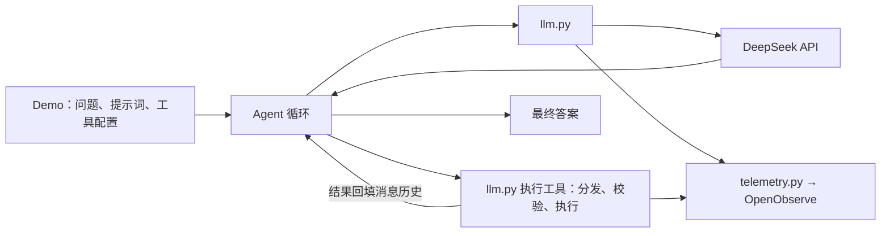

# Python 与 Agent 开发学习工作区

这个仓库用于学习 Python 和 Agent 开发。当前主线在 `agent-learning/`：用普通 Python 和 HTTP 调用 DeepSeek，手写 Agent 循环，并用 OpenObserve 记录模型请求、工具执行和运行结果。

`httpx` 负责直接调用模型，`python-dotenv` 读取配置，OpenTelemetry 负责观测；`langchain-core` 的工具组件生成乘法工具描述并校验参数。消息管理、工具调用适配和循环控制由项目代码实现。

当前维护的 Python 代码采用 Google Python 的命名规则，具体约定见 [项目 Python 规范](doc/python-style.md)。仓库根目录的 `ruff.toml` 统一配置格式和命名检查，覆盖通用工具包、Agent 课程与 Python 语法练习。

## 项目结构

```text
ai/
├── README.md                   # 工作区总览
├── pyproject.toml              # 通用工具包的依赖与安装配置
├── agent_toolkit/              # 可跨课程复用的 Agent 工具包
│   ├── __init__.py             # Python 包入口
│   ├── README.md               # 工具包说明与导入示例
│   ├── agent_loop.py           # 公用 Agent 循环
│   ├── llm.py                  # 模型客户端与工具执行入口
│   ├── session_store.py        # SQLite 会话存储
│   ├── settings.py             # 配置加载与校验
│   ├── telemetry.py            # 观测、脱敏与上报
│   └── tools.py                # 工具描述生成与通用调用适配
├── agent-learning/             # 当前 Agent 课程与可运行代码
│   ├── README.md               # Agent 课程运行说明
│   ├── demos/
│   │   ├── beginner/           # 3 个：问答、消息历史、工具循环
│   │   ├── intermediate/       # 4 个：JSON、流式、RAG、会话记忆
│   │   └── advanced/           # 3 个：思考模式、评估、资料 Agent
│   ├── toolbox.py              # 本地乘法工具
│   ├── retrieval.py            # 关键词检索与引用校验
│   ├── data/                   # 示例知识库、评估用例
│   ├── tests/                  # 离线回归测试
│   ├── offline_lab.py          # 测试用假 HTTP 和内存观测
│   ├── verify_observe.py       # 观测链路验证
│   ├── verify_live.py          # 真实模型分级验收
│   ├── pyproject.toml          # Python 版本、依赖与工具配置
│   ├── uv.lock                 # 依赖锁定
│   ├── .env.example            # 配置模板
│   └── .local/                 # 本地会话与报告，Git 忽略
├── doc/                        # 当前课程文档
│   ├── README.md               # 学习总入口
│   ├── levels/                 # 初级、中级、高级学习路线
│   ├── lessons/                # 8 篇底层原理讲解
│   ├── deepseek-demo.md        # DeepSeek 实验说明
│   ├── openobserve.md          # 观测接入与排错
│   ├── python-style.md         # Python 代码规范
│   ├── verification.md         # 验收记录
│   └── review.md               # Review 记录
├── python-learning/            # 独立的 Python 语法练习
│   ├── README.md               # 语法练习说明
│   ├── with_simple.py          # 文件读取、with / as
│   └── with_statement.py       # 资源清理、异常、SQLite 事务
├── old-workspace/              # 历史材料与框架学习存档
│   ├── openai-agents-python/   # Agents SDK 源码、示例、测试、文档
│   ├── agent-development/      # 早期 DeepSeek 示例
│   ├── archive/                # 之前的框架练习
│   └── doc/                    # 旧文档
├── pyrightconfig.json          # 工作区类型检查配置
└── ruff.toml                   # 统一的格式、导入排序与命名检查
```

目录树列出主要内容；`.venv/`、缓存等生成目录省略。`.local/` 用于存放本地练习数据，按需创建。当前 Agent 学习路径不依赖 `old-workspace/`。

## 核心模块职责

| 模块 | 职责 |
|---|---|
| [llm.py](agent_toolkit/llm.py) | 发送普通和流式 HTTP 请求、解析响应、统计 token、执行工具并记录观测信息 |
| [agent_loop.py](agent_toolkit/agent_loop.py) | 反复调用模型、执行工具、回填结果；限制模型轮数、工具次数和累计 token 软预算 |
| [tools.py](agent_toolkit/tools.py) | 从工具列表生成描述和白名单，通过参数模型校验后执行 |
| [toolbox.py](agent-learning/toolbox.py) | 声明乘法函数和本例可用工具 |
| [retrieval.py](agent-learning/retrieval.py) | 按关键词检索本地 JSON 资料，校验回答结构、来源 ID 和依据不足状态 |
| [session_store.py](agent_toolkit/session_store.py) | 按会话 ID 保存 SQLite 消息历史，用版本号防止并发覆盖 |
| [settings.py](agent_toolkit/settings.py) | 读取环境变量和 `agent-learning/.env`，校验模型与观测配置 |
| [telemetry.py](agent_toolkit/telemetry.py) | 创建 span、脱敏、限制正文长度，通过 OTLP 上报 OpenObserve |

Demo 与底层实现分开：10 个 demo 通过本地可编辑依赖复用根目录的 [agent_toolkit](agent_toolkit/README.md)。公用循环由调用方传入提示词、工具描述和分发函数，业务规则保留在具体示例中。

## Agent 运行关系

一次带工具的 Agent 运行会在模型请求与本地工具执行之间循环，直到获得最终回答或达到预算限制。



检索示例提供两种流程：

- [中级 RAG](agent-learning/demos/intermediate/intermediate_03_rag.py)：由程序固定执行“先检索、再生成”；关键词未命中时直接返回资料不足。
- [高级资料 Agent](agent-learning/demos/advanced/advanced_03_knowledge_agent.py)：使用专用循环，由模型选择搜索关键词，程序执行只读搜索工具并校验最终引用。

## 学习入口

完整学习路线见 [课程总入口](doc/README.md)。建议按以下顺序阅读：

1. [初级课程](doc/levels/beginner.md)：运行问答、消息历史和工具循环三个 demo。
2. 阅读 `agent_toolkit/llm.py`，了解 HTTP 请求、模型响应和客户端生命周期。
3. 阅读 `agent_toolkit/agent_loop.py` 与 `toolbox.py`，理解工具协议、结果回填和预算控制。
4. [中级课程](doc/levels/intermediate.md)：学习 JSON、流式输出、关键词 RAG 和 SQLite 会话。
5. [高级课程](doc/levels/advanced.md)：学习思考模式、固定用例评估和资料 Agent。
6. 阅读 `agent_toolkit/telemetry.py` 与 [OpenObserve 文档](doc/openobserve.md)，了解 trace、脱敏与上报。

Python 语法练习独立放在 [python-learning/](python-learning/README.md)，只使用标准库，不计入 Agent 课程的 10 个 demo。

## 运行与验证

Agent 命令从 `agent-learning/` 目录执行，需要 Python 3.11 或更新版本。新环境参考 [.env.example](agent-learning/.env.example) 创建并填写 `.env`；已有配置时保留原文件。真实 `.env` 被 Git 忽略，环境变量优先于 `.env`。

```bash
cd agent-learning
uv sync --locked

# 验证观测链路，不调用模型
uv run python verify_observe.py

# 运行第一个真实模型示例
uv run python -m demos.beginner.beginner_01_chat

# 离线回归测试，不调用模型，不上报 OpenObserve
uv run python -m unittest discover -s tests -v

# 按级进行真实模型与观测入库验收，会消耗 token
uv run python verify_live.py --level beginner
uv run python verify_live.py --level intermediate
uv run python verify_live.py --level advanced
```

更完整的命令见 [Agent 运行说明](agent-learning/README.md)，已有验收结果见 [验收记录](doc/verification.md)。

Python 语法练习从仓库根目录运行：

```bash
python3 python-learning/with_simple.py
python3 python-learning/with_statement.py
```
