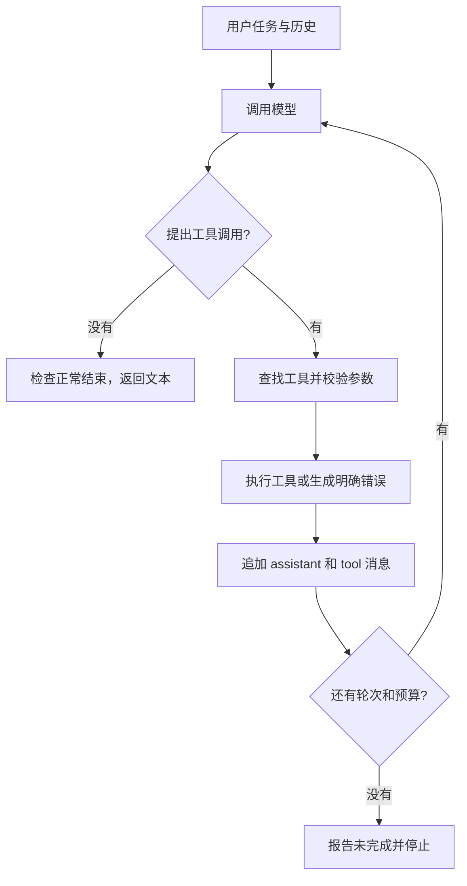

# 03：工具调用与手写 Agent 循环

## 先建立一个准确的理解

在本课程中，可以把最小 Agent 理解成：**模型根据当前状态提出行动，程序执行获准的行动，再把结果交给模型，直到完成或达到限制。** 模型、工具、状态、控制循环共同构成这个系统。

“请分步骤思考”是一种提示方式，不会自动赋予读文件、查询数据库或调用函数的能力。模型可以生成行动描述，真正的执行者是 Python。

## 我们为什么先用乘法工具

示例任务：每盒 17 支笔，23 盒是多少支？工具用确定性的本地乘法，没有天气接口、密钥、数据库等额外变量，也没有外部写入。你可以很容易地检查执行结果是否为 391。

即使模型自己也会算，这个实验仍有价值：目标是看见完整协议。提示词要求涉及乘法使用工具，但是否遵守仍应通过 trace 验证。

```bash
uv run python -m demos.beginner.beginner_03_agent_loop
```

阅读顺序：`toolbox.py` 的 `@tool` 函数 → demo 中的 `tools=[multiply]` → `agent_toolkit/agent_loop.py` 的 `run_agent()` → `agent_toolkit/tools.py` 的 `ToolSet.dispatch()`。暂时不需要钻进观测实现。

`run_agent()` 是公用函数，不内置计算助手的提示词或乘法工具。调用方通过两个必填关键字参数配置业务：`system_prompt` 定义角色与规则，`tools` 提供本次运行可用的工具列表。初级 demo 中的乘法助手只是其中一个使用方式：

```python
from agent_toolkit.agent_loop import run_agent
from agent_toolkit.llm import DeepSeekClient
from toolbox import multiply

with DeepSeekClient("my_agent") as llm_client:
    answer = run_agent(
        llm_client,
        "用工具计算 12 乘以 8。",
        system_prompt="你是计算助手。涉及乘法必须用工具。",
        tools=[multiply],
    )
```

复用到其他业务时，由调用方选择工具并替换这两个参数；`run_agent()` 在进入循环前准备工具描述与执行方法，保持两者一致。公用循环负责请求模型、执行工具、回填消息及预算限制。

## 第一步：描述工具，不是执行工具

内部生成的工具 schema 告诉模型 `multiply` 的含义、参数名和类型。它由函数声明自动生成。工具使用 `langchain-core` 的 `@tool` 声明，函数名、docstring、普通类型注解共同定义工具：

```python
@tool
def multiply(a: float, b: float) -> float:
    """计算两个数的乘积。涉及乘法时使用。"""
    return a * b
```

`toolbox.py` 只定义工具函数。调用方直接传入 `tools=[multiply]`，选择本次运行可用的工具。`run_agent()` 内部创建 `ToolSet`，从这份列表生成描述和工具注册表，统一配置严格参数校验；每次运行准备一次，而非每轮模型调用都重新准备。新增工具只需要定义带类型注解和 docstring 的 `@tool` 函数，在需要使用它的调用处加入工具列表，无需手写 schema 或添加专用分发分支。这个乘法示例没有业务范围限制，因此函数只声明两个普通 `float` 参数。

工具说明仍需符合实际用途；把描述写成“加法”，实现却做乘法，会误导模型。我们只使用工具组件，模型客户端、观测与 Agent 循环仍由课程代码实现。

## 第二步：模型返回一个调用请求

以下为示意响应片段：

```json
{
  "role": "assistant",
  "content": null,
  "tool_calls": [{
    "id": "call_example",
    "type": "function",
    "function": {"name": "multiply", "arguments": "{\"a\":17,\"b\":23}"}
  }]
}
```

`arguments` 是 **包含 JSON 的字符串**，要先 `json.loads()`，才得到 Python 字典。`content=null` 在工具调用中很正常，不能每次只读文本。协议及基本调用过程参见 [DeepSeek Tool Calls](https://api-docs.deepseek.com/guides/tool_calls/)。

## 第三步：程序决定能不能执行

`ToolSet.dispatch()` 做四件事：查找已注册工具；解析 JSON 参数；交给工具的参数模型校验字段和类型；通过 `.invoke()` 调用工具。它不会执行模型生成的 Python，更不会使用 `eval()` 或把字符串送进 shell。

本例只接受 `a`、`b` 两个有限数值。`float` 参数接受整数和浮点数，执行时按浮点数运算。通用适配层拒绝 bool、数值字符串、非有限数值和多余参数；函数无需为这些调用协议规则定义专用类型。参数出错时返回稳定的 `{'ok': False, 'error': ...}`，让模型可以看到实际失败，而不是编一个结果。

非法 JSON 返回 `invalid_json`；字段、类型或范围不符统一返回 `invalid_arguments`；工具执行异常返回 `tool_execution_failed`。返回格式仍为 `ok/result` 或 `ok/error`，参数错误码不再绑定乘法的 `a`、`b`。

业务调用通过 `llm_client.execute_tool(call, dispatch)`，它只负责记录工具的输入、输出和耗时，不替你实现工具。

## 第四步：保存调用消息，再回填执行结果

```python
messages.append(message)
messages.append({
    'role': 'tool',
    'tool_call_id': call['id'],
    'content': json.dumps(result, ensure_ascii=False),
})
```

必须保留模型原来的 assistant 消息，之后的 tool 消息通过 ID 与它配对。只有工具结果、没有对应调用，或者 ID 对不上，都会破坏对话结构。模型一次可能要求多个工具，程序要逐个处理并逐个回填；本项目顺序执行，方便看清流程。

## 第五步：把新的历史再发给模型



`run_agent()` 中这个循环是普通 `for`。在每个节点你都能打印或检查状态。它有模型轮次上限 5、工具次数上限 8、累计 token 软预算 8000；这些用于教学防止无界循环，详细区别见第六节。

典型运行应看到 2 次模型调用、1 次工具执行、1 个根 span。复杂任务或模型反复请求时数量会增加，工具链不保证总是四条。

## 实验

1. 把问题改成 12 盒、每盒 8 支。检查实际参数是否改变，工具结果是否 96。
2. 改为“分别计算 17×23 和 12×8”。观察它是在一轮返回多个 tool call，还是分轮请求，不预设固定轨迹。
3. 阅读 `ToolSet.dispatch()`，检查未知工具或错误 JSON 会返回什么错误对象。需要本地实验时可直接构造 `ToolSet([multiply])` 并调用 `.dispatch()`，不需要调用模型。
4. 将 `max_rounds` 改为 1。若第一轮产生工具调用，工具执行后没有第二次请求的额度，应明确报告未完成，不能伪装成最终成功。

## 自检

- 谁决定建议调用哪个工具？模型。谁决定是否真的允许？程序。
- 工具已经执行，为什么还要第二次模型调用？让模型根据实际结果组织答案或继续行动。
- 是否所有任务都应使用 Agent？不必。步骤固定且可确定实现的任务，普通函数或固定工作流往往更简单。

下一节：[结构化输出](04-json.md)。
