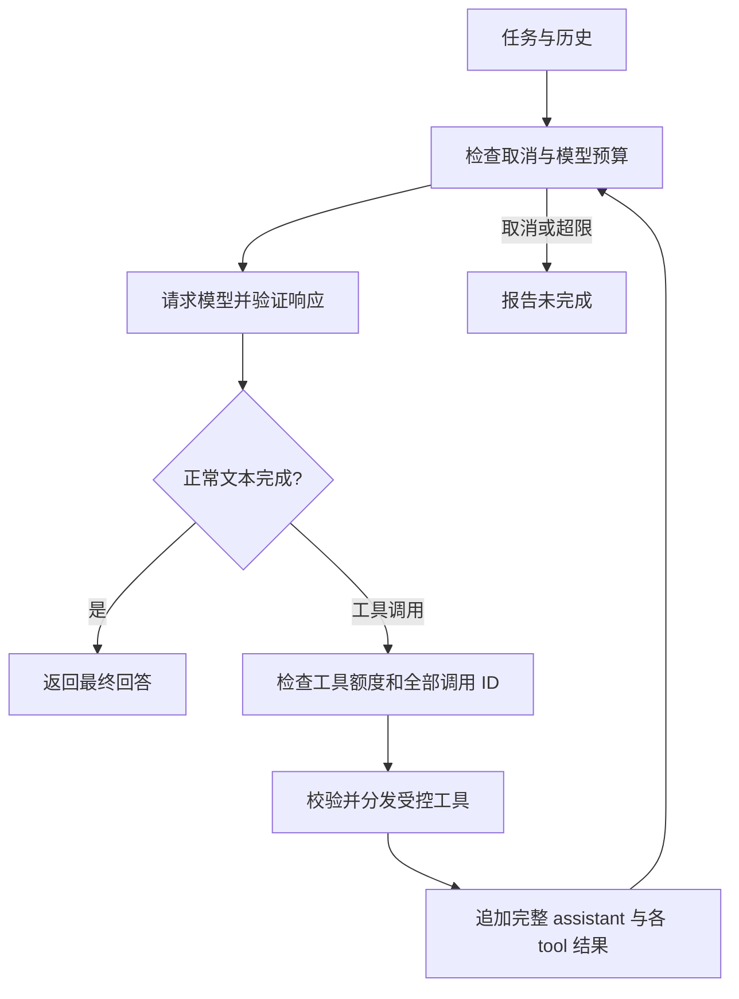

# 03：工具调用与手写 Agent 循环

## 模型提议，程序执行

最小 Agent 包含模型、工具、状态和控制循环：模型提出行动，程序执行获准行动，把真实结果交回模型，直到完成或达到限制。提示“分步骤思考”不会自动提供读文件或调用函数的能力。

本课计算“每盒 17 支笔，买 23 盒，一共多少支”，默认提示要求乘法调用工具。确定性的乘法工具便于核对 391；目标是看见实际协议，不只是让回答里出现数字。

阅读顺序：[工具](../../domain/agent/tools.go) 的 `Definitions` 和 `Dispatch` → [执行器](../../apps/demos/runner.go) 的工具包装 → [循环](../../domain/agent/loop.go) 的 `Run` → [协议](../../domain/agent/protocol.go)。本项目手写工具描述和校验，未引入 Python 装饰器或 Agent 框架。

## 描述与调用

`MultiplyTools.Definitions` 描述唯一工具 `multiply`，要求 `a`、`b` 为数值，禁止额外字段。描述供模型选择；真正能否执行仍由 `Dispatch` 校验。

模型可能返回以下 assistant 消息，并以 `tool_calls` 结束本轮：

```json
{
  "role": "assistant",
  "content": null,
  "tool_calls": [{
    "id": "call_example",
    "type": "function",
    "function": {"name":"multiply","arguments":"{\"a\":17,\"b\":23}"}
  }]
}
```

`arguments` 是内含 JSON 的字符串，必须解码后检查。工具轮的 `content:null` 是正常形态，不能只按文本消息读取响应。

## 校验与真实结果

分发器只接受注册的乘法工具；拒绝未知名称、无效 JSON、缺失或多余字段、重复字段、大小写别名、null、布尔、数值字符串及非有限数值。整数和小数都按有限浮点数处理，乘积溢出也不能当成功。

成功结果示意为 `{"ok":true,"result":391}`；错误使用 `unknown_tool`、`invalid_json`、`invalid_arguments` 或 `tool_execution_failed`。可处理的工具错误会回填给模型，让它看到真实失败；取消或执行层错误直接中止。程序不会把模型文本交给 shell，也不动态执行源码。

在一轮执行工具之前，循环先检查全部调用 ID，拒绝空 ID 或本次运行内的重复 ID，避免执行一半才发现配对错误。

## 完整保存与回填

先追加原始 assistant，再为每个调用追加结果：

```json
{"role":"tool","tool_call_id":"call_example","content":"{\"ok\":true,\"result\":391}"}
```

调用 ID 将 tool 结果与模型请求配对。下一次模型请求必须包含调用及结果，不能只把“391”作为新的 user 消息。一次可能有多个调用，本项目顺序执行并逐一回填。



`Run` 接收使用方定义的 `ChatClient`、`Tools`、问题、提示词与预算；通用循环不内置乘法题目。新工具需让描述与实际分发保持一致，并补相应契约测试。

## 操作与练习

1. 在工具循环页签执行默认题目，检查模型参数为 17、23，工具实际结果为 391，随后模型请求包含配对结果。
2. 改成“分别用工具计算 17×23 和 12×8”，观察一轮多个调用或多轮调用，不预设固定轨迹。
3. 阅读 `TestToolsRejectInvalidArguments`，离线构造无效参数，不用真实模型制造输入错误。
4. 临时将 `.env` 的 `AGENT_MAX_MODEL_CALLS` 改为 1，重启服务。若首轮提出工具请求，执行后没有模型额度，应返回 `budget_exceeded` 和未完成，实验后恢复为 5。

默认限制为模型 5 次、工具分发 8 次、累计已知 token 8000；token 是调用间软预算，详见 [失败与预算](06-reliability.md)。典型轨迹为根 + 模型 + 工具 + 模型，共 4 个 span，实际数量以步骤为准。

## 通过标准

- 能指出是谁提出调用、谁执行与校验、谁生成最终文字。
- 能从下一次请求找到完整 assistant 和按 ID 配对的工具结果。
- 能解释工具错误如何回填，以及工具已执行但任务为何仍可能未完成。
- 能用实际工具证据证明结果，区分固定流程与模型决定行动的循环。

后续专题：[结构化输出](04-json.md)，当前尚未实现。
